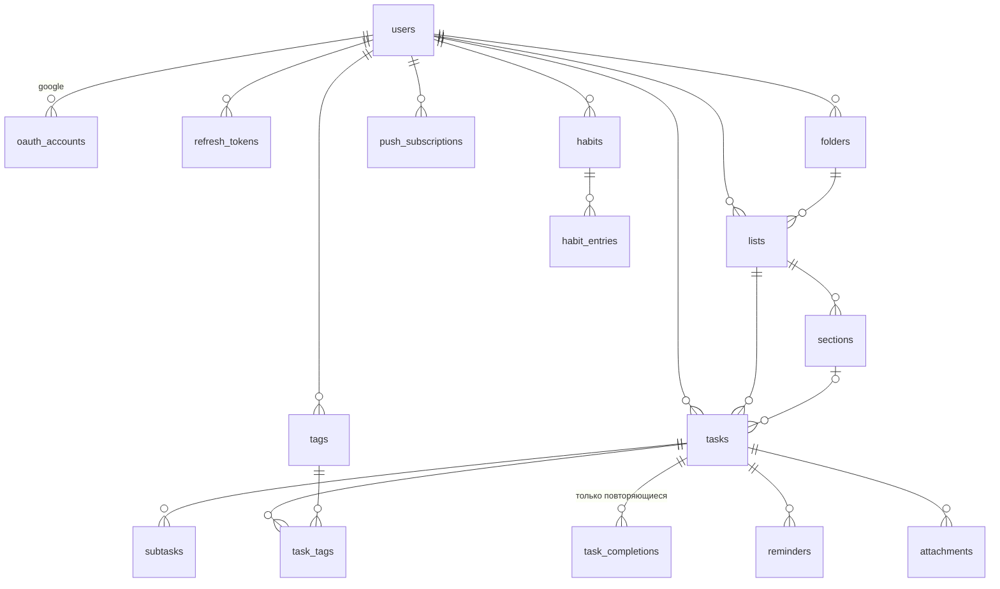

# Plana — схема базы данных (ERD)

Статус: утверждена 2026-10-09 как основа для первой миграции Drizzle. Изменения схемы — только через новые миграции + правка этого документа.

Стек: PostgreSQL 16+, Drizzle ORM (`apps/api/src/db/schema.ts`), миграции — drizzle-kit в `apps/api/drizzle/`.

## Общие правила

- PK: `uuid` c `gen_random_uuid()` (генерирует БД).
- Все моменты времени — `timestamptz` в UTC. Календарные дни пользователя (дата задачи, день привычки) — тип `date` (`YYYY-MM-DD`), интерпретируется в таймзоне пользователя (`users.timezone`, IANA-имя).
- Мягкое удаление: `trashed_at timestamptz` (корзина). Полное удаление — воркером через 30 дней.
- Порядок (drag&drop): колонка `position integer`, шаг 1024. При переполнении (разрыв < 1) — пакетная перенумерация слайса; операция редкая, отдельного типа fractional indexing не вводим.
- Все дочерние строки удаляются `ON DELETE CASCADE`.
- `created_at` / `updated_at` (`timestamptz not null default now()`) — у каждой таблицы, ниже не повторяются.

## Диаграмма

## Таблицы

### users

| Колонка         | Тип                                                     | Примечание                                                                            |
| --------------- | ------------------------------------------------------- | ------------------------------------------------------------------------------------- |
| id              | uuid PK                                                 |                                                                                       |
| email           | text not null                                           | уникальность: `unique index on lower(email)` (нормализация в коде — всегда lowercase) |
| password_hash   | text null                                               | null — если аккаунт только через Google OAuth                                         |
| name            | text not null                                           |                                                                                       |
| timezone        | text not null default 'UTC'                             | IANA, напр. 'Europe/Moscow'                                                           |
| theme           | enum('system','light','dark') not null default 'system' |                                                                                       |
| avatar_url      | text null                                               |                                                                                       |
| google_picture? | —                                                       | не храним, картинка берётся из oauth_accounts при логине                              |

### oauth_accounts

Привязка внешних провайдеров (MVP: google).

| Колонка             | Тип                                                  |
| ------------------- | ---------------------------------------------------- |
| id                  | uuid PK                                              |
| user_id             | uuid → users CASCADE                                 |
| provider            | text not null ('google')                             |
| provider_account_id | text not null (Google `sub`)                         |
| email               | text null (email Google-аккаунта на момент привязки) |

Индексы: `unique(provider, provider_account_id)`, `(user_id)`.

### refresh_tokens

Сессии. Один пользователь — много сессий (браузер, телефон). Ротация: при использовании старый помечается `revoked_at`, выдаётся новый.

| Колонка    | Тип                                                           |
| ---------- | ------------------------------------------------------------- |
| id         | uuid PK                                                       |
| user_id    | uuid → users CASCADE                                          |
| token_hash | text not null (sha256 от refresh-токена; сам токен не храним) |
| expires_at | timestamptz not null (30 дней)                                |
| revoked_at | timestamptz null                                              |
| user_agent | text null (для списка «активные сессии», post-MVP)            |

Индексы: `unique(token_hash)`, `(user_id)`.

### folders

| Колонка  | Тип                  |
| -------- | -------------------- |
| id       | uuid PK              |
| user_id  | uuid → users CASCADE |
| name     | text not null        |
| position | integer not null     |

### lists

| Колонка    | Тип                                                                       |
| ---------- | ------------------------------------------------------------------------- |
| id         | uuid PK                                                                   |
| user_id    | uuid → users CASCADE                                                      |
| folder_id  | uuid → folders null, ON DELETE SET NULL (папку удалили — списки остались) |
| name       | text not null                                                             |
| color      | text not null default 'gray' (ключ из фиксированной палитры фронтенда)    |
| icon       | text null (ключ из фиксированного реестра иконок фронтенда)               |
| emoji      | text null (один эмодзи-символ)                                            |
| kind       | enum('inbox','regular') not null default 'regular'                        |
| position   | integer not null                                                          |
| trashed_at | timestamptz null                                                          |

Индексы: `unique(user_id) where kind = 'inbox'` — Inbox ровно один на пользователя, создаётся при регистрации; `(user_id)`.

Удаление списка: `trashed_at` списку и всем его задачам. Удаление Inbox запрещено (бизнес-правило сервиса).

### sections

| Колонка  | Тип                  |
| -------- | -------------------- |
| id       | uuid PK              |
| list_id  | uuid → lists CASCADE |
| name     | text not null        |
| position | integer not null     |

### tasks

Центральная таблица.

| Колонка          | Тип                                                        | Примечание                                                                              |
| ---------------- | ---------------------------------------------------------- | --------------------------------------------------------------------------------------- |
| id               | uuid PK                                                    |                                                                                         |
| user_id          | uuid → users CASCADE                                       | денормализация: все запросы фильтруются по пользователю                                 |
| list_id          | uuid → lists CASCADE                                       |                                                                                         |
| section_id       | uuid → sections null, ON DELETE SET NULL                   |                                                                                         |
| title            | text not null                                              |                                                                                         |
| description      | text not null default ''                                   | Markdown, рендер на клиенте (sanitized)                                                 |
| priority         | enum('none','low','medium','high') not null default 'none' |                                                                                         |
| due_date         | date null                                                  | календарный день в TZ пользователя; null = без даты                                     |
| due_time         | time null                                                  | null = «весь день»; имеет смысл только при due_date not null                            |
| rrule            | text null                                                  | RFC 5545 без DTSTART, напр. `FREQ=WEEKLY;BYDAY=MO,WE;INTERVAL=2`                        |
| rrule_start_date | date null                                                  | DTSTART для вычисления вхождений (при создании повтора = due_date)                      |
| pinned           | boolean not null default false                             |                                                                                         |
| position         | integer not null                                           | порядок внутри (list_id, section_id)                                                    |
| completed_at     | timestamptz null                                           | завершённые видны в Completed; у повторяющихся почти всегда null (см. task_completions) |
| trashed_at       | timestamptz null                                           | корзина                                                                                 |

Семантика повторов: `due_date/due_time` всегда хранят **следующее** вхождение. Завершение повторяющейся задачи: (1) вставка в `task_completions`, (2) пересчёт `due_date` на следующее вхождение (библиотека `rrule`, таймзона пользователя). Если правило исчерпано (UNTIL/COUNT) — задача закрывается обычным образом (`completed_at`). Завершение обычной задачи — только `completed_at`.

Индексы: `(user_id, due_date)`, `(user_id, list_id)`, `(user_id, completed_at)`, `(user_id, pinned)`, GIN pg_trgm на `title` и `description` (поиск `ILIKE '%q%'`).

### subtasks

| Колонка  | Тип                            |
| -------- | ------------------------------ |
| id       | uuid PK                        |
| task_id  | uuid → tasks CASCADE           |
| title    | text not null                  |
| done     | boolean not null default false |
| position | integer not null               |

Подзадачи MVP — плоский чеклист без своих дат (как у TickTick).

### tags

| Колонка  | Тип                                                          |
| -------- | ------------------------------------------------------------ |
| id       | uuid PK                                                      |
| user_id  | uuid → users CASCADE                                         |
| name     | text not null                                                |
| color    | text not null default 'gray' (ключ из фиксированной палитры) |
| icon     | text null (ключ из фиксированного реестра иконок фронтенда)  |
| position | integer not null                                             |

Индекс: `unique(user_id, lower(name))`. Тег создаётся неявно при первом использовании в задаче, удаляется — только явно пользователем.

### task_tags

| Колонка | Тип                  |
| ------- | -------------------- |
| task_id | uuid → tasks CASCADE |
| tag_id  | uuid → tags CASCADE  |

PK: `(task_id, tag_id)`.

### task_completions

История завершённых **вхождений** повторяющихся задач (для Completed/Recent и будущей статистики). Обычные задачи сюда не пишутся — у них `completed_at`.

| Колонка         | Тип                                |
| --------------- | ---------------------------------- |
| id              | uuid PK                            |
| task_id         | uuid → tasks CASCADE               |
| user_id         | uuid → users CASCADE               |
| occurrence_date | date not null                      | какое вхождение закрыли (= due_date на момент завершения) |
| completed_at    | timestamptz not null default now() | фактический момент                                        |

Индекс: `(user_id, completed_at)`, `(task_id)`.

### reminders

MVP: напоминания задаются **смещением от времени задачи** (offset), а не абсолютным временем — тогда при сдвиге даты (в т.ч. повтором) напоминание следует за задачей автоматически. Произвольное время без привязки к задаче — post-MVP.

| Колонка              | Тип                                                          | Примечание                                                                                 |
| -------------------- | ------------------------------------------------------------ | ------------------------------------------------------------------------------------------ |
| id                   | uuid PK                                                      |                                                                                            |
| task_id              | uuid → tasks CASCADE                                         |                                                                                            |
| user_id              | uuid → users CASCADE                                         |                                                                                            |
| offset_minutes       | integer not null (0 = в момент времени; 15 = за 15 минут до) |                                                                                            |
| sent_occurrence_date | date null                                                    | для какого вхождения уже отправлено; сбрасывается в null при изменении даты/времени задачи |

Логика воркера (каждую минуту): найти задачи, у которых `reminder_time = due_date + due_time - offset` <= now (в TZ пользователя), задача не завершена/не в корзине, `sent_occurrence_date is distinct from due_date` → отправить push во все подписки пользователя, записать `sent_occurrence_date = due_date`.

### attachments

| Колонка     | Тип                  | Примечание                                                                    |
| ----------- | -------------------- | ----------------------------------------------------------------------------- |
| id          | uuid PK              |                                                                               |
| task_id     | uuid → tasks CASCADE |                                                                               |
| user_id     | uuid → users CASCADE |                                                                               |
| file_name   | text not null        |                                                                               |
| mime_type   | text not null        |                                                                               |
| size_bytes  | integer not null     | лимит 10 МБ на файл; сумма по пользователю ≤ 100 МБ (проверка в сервисе)      |
| storage_key | text not null        | `attachments/{userId}/{attachmentId}/{safeFileName}` в Railway Object Storage |
| uploaded_at | timestamptz null     | подтверждение загрузки; неподтверждённые > 1 часа чистит воркер               |

### push_subscriptions

Web Push подписки браузеров (RFC 8291). Один пользователь — много устройств.

| Колонка    | Тип                                               |
| ---------- | ------------------------------------------------- |
| id         | uuid PK                                           |
| user_id    | uuid → users CASCADE                              |
| endpoint   | text not null (уникален по спецификации Web Push) |
| p256dh     | text not null                                     |
| auth       | text not null                                     |
| user_agent | text null                                         |

Индексы: `unique(endpoint)`, `(user_id)`.

### habits

| Колонка      | Тип                                             | Примечание                                                |
| ------------ | ----------------------------------------------- | --------------------------------------------------------- |
| id           | uuid PK                                         |                                                           |
| user_id      | uuid → users CASCADE                            |                                                           |
| name         | text not null                                   |                                                           |
| type         | enum('check','number') not null default 'check' |                                                           |
| target_value | integer null                                    | только для type='number': цель в день (напр. 8)           |
| days_of_week | integer not null default 127                    | битовая маска пн..вс (bit 0 = понедельник, 127 = все дни) |
| color        | text not null default 'gray'                    |                                                           |
| position     | integer not null                                |                                                           |
| archived_at  | timestamptz null                                | архив вместо удаления                                     |

### habit_entries

Чек-ины по дням. Нет записи = день не выполнен.

| Колонка  | Тип                        | Примечание                                         |
| -------- | -------------------------- | -------------------------------------------------- |
| id       | uuid PK                    |                                                    |
| habit_id | uuid → habits CASCADE      |                                                    |
| user_id  | uuid → users CASCADE       |                                                    |
| date     | date not null              | локальный день пользователя                        |
| value    | integer not null default 1 | check: 1 = выполнено; number: фактическое значение |

Индекс: `unique(habit_id, date)`, `(user_id, date)`.

## Фоновая чистка (cron-воркер)

- Задачи/списки с `trashed_at < now() - 30 days` — удалить физически (каскад уберёт подзадачи, теги-связи, напоминания, вложения; файлы вложений — из бакета).
- `attachments.uploaded_at is null and created_at < now() - 1 hour` — удалить метаданные и объект в бакете.
- `refresh_tokens` с `expires_at < now() - 7 days` — удалить.

## Что сознательно не в схеме

- Смарт-списки (Today, Next 7 Days, …) — вычисляются запросами, не хранятся.
- Выполненные подзадачи повторяющихся задач — не переносятся (TickTick сбрасывает чеклист каждого вхождения; делаем так же: при завершении вхождения `subtasks.done` сбрасывается в false).
- Пользовательские фильтры, совместный доступ, комментарии — post-MVP (при добавлении: таблицы `filters`, `list_members`, `comments`).
